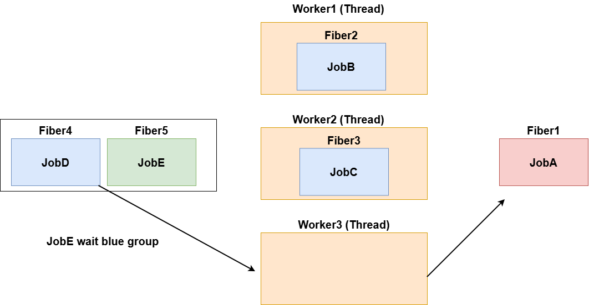
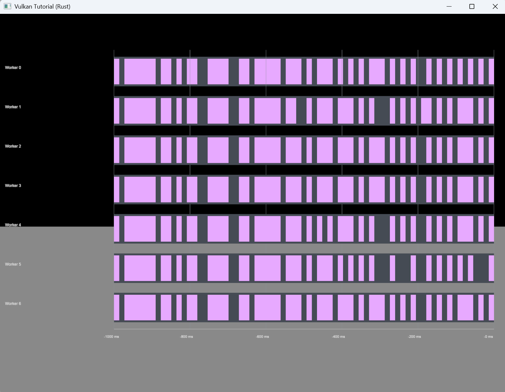

# JobApi

Parallelism means executing multiple operations at the same time, for example on multiple CPU cores. Concurrency means making progress on multiple operations. Concurrent work can be interleaved on one core or run in parallel on multiple cores.

For example, one core can perform collision detection while another computes AI decisions. Two cores can also share a large batch of collision tests. When tasks depend on each other, their execution order and synchronization must be managed.

Concurrency also allows other work to progress while a file download waits for I/O. Running other tasks during these waits can improve CPU utilization. However, blocking I/O inside a job is not automatically converted into a fiber wait.

## Workers and job fibers

By default, KaniVolcanoEngine creates one fewer worker thread than the available parallelism, with a minimum of one worker. The initial job fiber count is four times the worker count.

A worker is a thread that executes jobs, where a job is one unit of work. Each worker converts its own thread into a manager fiber during startup. This manager fiber belongs to that worker and is separate from the shared job fiber pool.

Submitted jobs enter a shared queue and are assigned to free job fibers. A worker switches from its manager fiber to a job fiber to execute the task. When the job completes or waits for other jobs, it returns to the manager fiber, allowing the worker to execute other work. A waiting job fiber may resume on another worker after its dependencies finish. Additional job fibers are created if the pool runs out of free fibers.

Fiber switching is managed by the application. Job creation, queue submission, synchronization, and fiber switching still have costs, so parallelizing every operation does not necessarily make it faster.



## Example

The following `ParallelRotatorSystem` rotates objects with a `Rotator` component in parallel. The engine's `Rotator` stores rotation speed as follows:

```rust
use cgmath::Vector3;
use kani_volcano_engine::Component;

pub struct Rotator {
    pub speed: Vector3<f32>,
}

impl Component for Rotator {}
```

The system below imports and uses the engine-provided `Rotator`.

```rust
use anyhow::Result;
use kani_volcano_engine::{EntityApi, JobApi, Rotator, TimeApi, UpdateContext, UpdateSystem};
use kani_volcano_math::Transform;

#[derive(Default)]
pub struct ParallelRotatorSystem {}

impl UpdateSystem for ParallelRotatorSystem {
    fn update(&mut self, context: &mut UpdateContext<'_>) -> Result<()> {
        // Get an owned JobSystemHandle before borrowing components.
        let jobs = context.job_system()?;
        let dt = context.delta_seconds();

        let mut entries: Vec<_> = context.query2_mut::<Transform, Rotator>().collect();

        unsafe {
            jobs.scope(|scope| -> Result<()> {
                // Processing before submitting child jobs runs on the calling thread.

                // Create a group to track these child jobs.
                let group = scope.group();

                for chunk in entries.chunks_mut(256) {
                    scope.spawn(&group, "rotate_chunk", move || {
                        // This closure runs on a worker.
                        for (_, transform, rotator) in chunk {
                            transform.rotate(rotator.speed * dt);
                        }
                    })?;
                }

                // Wait for all jobs in this group to finish.
                scope.wait(&group)?;

                // Processing after the wait runs on the calling thread.

                Ok(())
            })
        }??;
        Ok(())
    }
}
```

`context.job_system()` returns a `JobSystemHandle` for the engine's job system. During update and fixed update stages, the Scheduler registers a handle in the calling thread's TLS. Obtaining the handle does not retain a borrow of the Context, so components can be borrowed mutably afterward.

1. `jobs.scope(...)` starts a scope for jobs that borrow data. All jobs submitted through that scope finish before it exits, even if an explicit `wait()` is omitted.
2. `scope.group()` creates a group that tracks completion of a set of jobs.
3. `scope.spawn(&group, name, func)` submits `func` (`FnOnce() + Send`) to the shared job queue and registers it with the group. `name` labels the job for profiling. Jobs with the same name still have distinct JobIds. This example gives each job a disjoint chunk of up to 256 entries.
4. `scope.wait(&group)` waits for every job in the group to finish. Waiting seals the group against further submissions; use a new group for subsequent jobs.

For example, to run jobs B, C, and D in parallel after processing A, then use their results in processing E, register B, C, and D in the same group. Run A, submit the child jobs, and run E after `scope.wait(&group)?`. The scope closure itself is not automatically submitted as a job.

An `update()` called by the current Scheduler executes on the main thread. In this example, the main thread waits for the child jobs, then continues with subsequent processing. When a job running on a worker calls `wait()`, its job fiber suspends and the worker can execute other jobs.

The final `??` propagates both errors from `scope()` itself and the `Result` returned by its closure.

## Unsafe requirements

Currently, `scope()` and `wait()` are `unsafe`. When called on a worker, the suspended fiber may resume on another worker. Every live value and reference on the entire suspended stack, including caller frames, must support this migration. Do not keep thread-affine guards, TLS references, or non-`Send` values across a wait. A `Send` closure does not guarantee that local variables created inside it can migrate.

Also avoid waiting on a group that includes the waiting job itself, and avoid cyclic dependencies.

## Work suited to parallel execution

This `ParallelRotatorSystem` demonstrates API usage; it is not a good candidate for speeding up lightweight rotation updates. Each object update mainly multiplies rotation speed by elapsed time and adds the result to the rotation angles. It does not perform a matrix calculation during the update.

When the computation per job is small, submission, synchronization, and fiber switching can cost more than the time saved by parallel execution. This example also collects query results into a `Vec` serially. In our measurements, the sequential `RotatorSystem` was faster.

Try increasing the number of entries per job to reduce the job count, or target more computationally expensive work such as:

- Animation interpolation and bone matrix calculations
- AI pathfinding
- Collision tests for independent candidate pairs
- Terrain or mesh vertex, index, and normal generation

Measure the results against a sequential implementation. Split mutable data into disjoint regions, and perform thread-affine operations such as GPU resource registration on the appropriate thread after gathering the computed results.

## Profiling

KaniVolcanoEngine provides APIs for retrieving the worker count and job execution histories. These APIs allow user-defined systems to inspect execution activity or visualize it as a timeline.

History is recorded in `JobRunSegment` entries. Each entry represents one interval during which a job ran on a particular worker. When waiting and resuming split a job into multiple intervals, the same JobId identifies them. Only records remaining within the history capacity are available.

### Getting the worker count

```rust
let worker_count: usize = context.worker_count()?;
```

Returns the number of workers in the JobSystem. Worker IDs range from `0` to `worker_count - 1`.

### Getting execution history by worker ID

```rust
let segments = context.worker_history(0)?;
```

Returns the specified worker's execution history as a `VecDeque<JobRunSegment>`, ordered from oldest to newest. This example retrieves Worker 0's history. An invalid worker ID returns an error.

The returned collection is a copy of the internal history. Modifying it does not affect the records retained by the JobSystem.

### Getting execution history by job name

```rust
let segments: Vec<JobRunSegment> =
    context.get_job_segments_from_name("rotate_chunk")?;
```

Searches all worker histories for execution intervals whose job name exactly matches the specified name. Results are ordered by start time. If no records match, an empty `Vec` is returned. Separate jobs submitted with the same name are included, so use JobId to distinguish individual jobs.

### Visualizing execution history



The image shows the execution history of the parallel rotation jobs. Each worker has its own row, and execution intervals are displayed on a shared time axis.

By default, `ThreadProfilerSystem` refreshes the display every 100 ms and shows the most recent second of history. It reuses drawing entities and groups short intervals into fixed-width time bins to limit display overhead. A colored bin therefore means that some recorded work occurred during that period, not that the worker was busy for the entire bin. Recorded intervals also include time when the OS descheduled the thread, so this is not an exact measurement of CPU utilization.

The following examples show the visualization system's implementation and its registration in a Scene.

`thread_profiler_system.rs`

```rust
use super::{UpdateContext, UpdateSystem};
use crate::{
    AssetApi, EntityApi, EntityId, FontAssetId, JobApi, JobRunSegment, Material, MeshAssetId,
    MeshRenderer, ObjectApi, SceneId, SceneOwned, Text, TextPipeline, Visibility,
};
use anyhow::{Result, ensure};
use cgmath::{vec2, vec3};
use kani_volcano_math::Transform;
use renderer_vulkan::{PipelineKey, VertexLayout};
use std::time::{Duration, Instant};

const LEFT: f32 = -0.55;
const RIGHT: f32 = 0.95;
const TOP: f32 = 0.8;
const BOTTOM: f32 = -0.65;
// Bound draw objects independently of the much larger retained job history.
const TOTAL_BINS: usize = 512;
const MAX_BINS_PER_WORKER: usize = 256;

/// Screen-space timeline of retained, completed worker dispatches.
/// Both assets must be centered white 1x1 rectangles with Ui2D vertex layout.
/// line_mesh_id is drawn as a thin rectangle, not a DebugLine3D line-list mesh.
///
/// Register with add_update_system, after the systems being observed. Labels use
/// the first loaded font, if any. Set scene_id for scene-owned overlay entities.
/// Bars are quantized to a bounded number of time bins; colors group job names.
/// This is a timeline of recorded job dispatches, not measured OS CPU utilization.
pub struct ThreadProfilerSystem {
    pub rect_mesh_id: MeshAssetId,
    pub line_mesh_id: MeshAssetId,
    pub refresh_interval: Duration,
    pub time_window: Duration,
    pub scene_id: Option<SceneId>,
    last_refresh: Option<Instant>,
    rectangles: Vec<EntityId>,
    lines: Vec<EntityId>,
    labels: Vec<EntityId>,
}

impl ThreadProfilerSystem {
    pub fn new(rect_mesh_id: MeshAssetId, line_mesh_id: MeshAssetId) -> Self {
        Self {
            rect_mesh_id,
            line_mesh_id,
            refresh_interval: Duration::from_millis(100),
            time_window: Duration::from_secs(1),
            scene_id: None,
            last_refresh: None,
            rectangles: Vec::new(),
            lines: Vec::new(),
            labels: Vec::new(),
        }
    }

    /// Remove this system's overlay before removing the system itself.
    /// Alternatively, assign scene_id and let scene cleanup remove the entities.
    pub fn clear(&mut self, context: &mut UpdateContext<'_>) {
        for id in self
            .rectangles
            .drain(..)
            .chain(self.lines.drain(..))
            .chain(self.labels.drain(..))
        {
            context.despawn(id);
        }
        self.last_refresh = None;
    }

    fn validate_mesh(context: &UpdateContext<'_>, id: MeshAssetId) -> Result<()> {
        let layout = context
            .mesh_assets()
            .find(|(asset_id, _)| *asset_id == id)
            .map(|(_, asset)| asset.handle.vertex_layout);
        ensure!(
            layout == Some(VertexLayout::Ui2D),
            "ThreadProfilerSystem mesh {:?} must be a centered white 1x1 Ui2D rectangle",
            id
        );
        Ok(())
    }

    fn tag(context: &mut UpdateContext<'_>, id: EntityId, scene_id: Option<SceneId>) {
        context.set_tags(id, ["ThreadProfiler"]);
        if let Some(scene_id) = scene_id {
            context.add_component(id, SceneOwned { scene_id });
        }
    }

    // Reuse the supplied mesh through ObjectApi; never create GPU meshes here.
    fn spawn_rectangle_from_mesh(
        context: &mut UpdateContext<'_>,
        mesh: MeshAssetId,
        scene_id: Option<SceneId>,
    ) -> Result<EntityId> {
        let id = context.spawn_primitive_from_mesh(
            mesh,
            Material {
                pipeline_key: PipelineKey::Ui2D,
                ..Material::default()
            },
            Transform::default(),
        )?;
        Self::tag(context, id, scene_id);
        Ok(id)
    }

    fn rectangle(
        context: &mut UpdateContext<'_>,
        mesh: MeshAssetId,
        pool: &mut Vec<EntityId>,
        used: &mut usize,
        scene_id: Option<SceneId>,
        center: cgmath::Vector2<f32>,
        size: cgmath::Vector2<f32>,
        color: cgmath::Vector3<f32>,
    ) -> Result<()> {
        let existing = pool.get(*used).copied().filter(|id| {
            context
                .get_component::<MeshRenderer>(*id)
                .is_some_and(|renderer| renderer.asset_id == Some(mesh))
                && context.has_component::<Transform>(*id)
                && context.has_component::<Visibility>(*id)
        });
        let id = if let Some(id) = existing {
            id
        } else {
            if let Some(&old) = pool.get(*used) {
                context.despawn(old);
            }
            let id = Self::spawn_rectangle_from_mesh(context, mesh, scene_id)?;
            if *used == pool.len() {
                pool.push(id);
            } else {
                pool[*used] = id;
            }
            id
        };
        // Ui2D uses position.yz and scale.yz; its vertex shader ignores rotation.
        *context.get_component_mut::<Transform>(id).unwrap() = Transform {
            position: vec3(0.0, center.x, center.y),
            scale: vec3(1.0, size.x, size.y),
            ..Transform::default()
        };
        context
            .get_component_mut::<MeshRenderer>(id)
            .unwrap()
            .material
            .color = color;
        context
            .get_component_mut::<Visibility>(id)
            .unwrap()
            .is_visible = true;
        *used += 1;
        Ok(())
    }

    fn label(
        &mut self,
        context: &mut UpdateContext<'_>,
        used: &mut usize,
        font: FontAssetId,
        content: String,
        x: f32,
        y: f32,
        font_size: f32,
    ) {
        let id = if let Some(id) = self.labels.get(*used).copied().filter(|id| {
            context.has_component::<Text>(*id)
                && context.has_component::<Transform>(*id)
                && context.has_component::<Visibility>(*id)
        }) {
            id
        } else {
            if let Some(&old) = self.labels.get(*used) {
                context.despawn(old);
            }
            let id = context.spawn();
            Self::tag(context, id, self.scene_id);
            context.add_component(id, Transform::default());
            context.add_component(id, Visibility::default());
            context.add_component(
                id,
                Text {
                    content: String::new(),
                    font,
                    font_size,
                    line_height: font_size,
                    color: vec3(0.9, 0.9, 0.9),
                    alpha: 1.0,
                    text_pipeline: TextPipeline::Ui2D,
                },
            );
            if *used == self.labels.len() {
                self.labels.push(id);
            } else {
                self.labels[*used] = id;
            }
            id
        };
        let text = context.get_component_mut::<Text>(id).unwrap();
        if text.content != content {
            text.content = content;
        }
        text.font = font;
        text.font_size = font_size;
        text.line_height = font_size;
        // TextUi2D anchors use XY, with positive Y downward (unlike Ui2D rectangles).
        context.get_component_mut::<Transform>(id).unwrap().position = vec3(x, -y, 0.0);
        context
            .get_component_mut::<Visibility>(id)
            .unwrap()
            .is_visible = true;
        *used += 1;
    }

    fn hide_unused(context: &mut UpdateContext<'_>, pool: &[EntityId], used: usize) {
        for &id in &pool[used..] {
            if let Some(visibility) = context.get_component_mut::<Visibility>(id) {
                visibility.is_visible = false;
            }
        }
    }
}

impl UpdateSystem for ThreadProfilerSystem {
    fn update(&mut self, context: &mut UpdateContext<'_>) -> Result<()> {
        let now = Instant::now();
        if self
            .last_refresh
            .is_some_and(|last| now.duration_since(last) < self.refresh_interval)
        {
            return Ok(());
        }
        ensure!(
            !self.time_window.is_zero(),
            "profiler time_window must be positive"
        );
        Self::validate_mesh(context, self.rect_mesh_id)?;
        Self::validate_mesh(context, self.line_mesh_id)?;

        let jobs = context.job_system()?;
        let worker_count = context.worker_count()?;
        // Capture once so every worker uses the same time window.
        let end = jobs.profiler().elapsed();
        let font = context.font_assets().next().map(|(id, _)| id);
        let row_height = (TOP - BOTTOM) / worker_count.max(1) as f32;
        let bin_count = (TOTAL_BINS / worker_count.max(1)).clamp(1, MAX_BINS_PER_WORKER);
        let mut bins = vec![None; bin_count];
        let (mut rectangles, mut lines, mut labels) = (0, 0, 0);

        for worker in 0..worker_count {
            let history = context.worker_history(worker)?;
            fill_bins(history.iter(), end, self.time_window, &mut bins);
            let y = TOP - (worker as f32 + 0.5) * row_height;
            Self::rectangle(
                context,
                self.rect_mesh_id,
                &mut self.rectangles,
                &mut rectangles,
                self.scene_id,
                vec2((LEFT + RIGHT) * 0.5, y),
                vec2(RIGHT - LEFT, row_height * 0.75),
                vec3(0.06, 0.07, 0.09),
            )?;

            let mut bin = 0;
            while bin < bin_count {
                let Some(color_index) = bins[bin] else {
                    bin += 1;
                    continue;
                };
                let start = bin;
                while bin < bin_count && bins[bin] == Some(color_index) {
                    bin += 1;
                }
                let left = LEFT + (RIGHT - LEFT) * start as f32 / bin_count as f32;
                let right = LEFT + (RIGHT - LEFT) * bin as f32 / bin_count as f32;
                Self::rectangle(
                    context,
                    self.rect_mesh_id,
                    &mut self.rectangles,
                    &mut rectangles,
                    self.scene_id,
                    vec2((left + right) * 0.5, y),
                    vec2(right - left, row_height * 0.65),
                    job_color(color_index),
                )?;
            }
            if let Some(font) = font {
                self.label(
                    context,
                    &mut labels,
                    font,
                    format!("Worker {worker}"),
                    -0.98,
                    y + row_height * 0.15,
                    (row_height * 300.0).clamp(4.0, 12.0),
                );
            }
        }

        // Six grid lines, with labels relative to the captured window end.
        for tick in 0..=5 {
            let fraction = tick as f32 / 5.0;
            let x = LEFT + (RIGHT - LEFT) * fraction;
            Self::rectangle(
                context,
                self.line_mesh_id,
                &mut self.lines,
                &mut lines,
                self.scene_id,
                vec2(x, (TOP + BOTTOM) * 0.5),
                vec2(0.001, TOP - BOTTOM + 0.02),
                vec3(0.25, 0.27, 0.30),
            )?;
            if let Some(font) = font {
                let ms = self.time_window.as_secs_f64() * 1000.0 * (1.0 - f64::from(fraction));
                self.label(
                    context,
                    &mut labels,
                    font,
                    format!("-{ms:.0} ms"),
                    x - 0.04,
                    BOTTOM - 0.04,
                    11.0,
                );
            }
        }
        Self::rectangle(
            context,
            self.line_mesh_id,
            &mut self.lines,
            &mut lines,
            self.scene_id,
            vec2((LEFT + RIGHT) * 0.5, BOTTOM - 0.01),
            vec2(RIGHT - LEFT, 0.002),
            vec3(0.5, 0.5, 0.5),
        )?;
        Self::hide_unused(context, &self.rectangles, rectangles);
        Self::hide_unused(context, &self.lines, lines);
        Self::hide_unused(context, &self.labels, labels);
        self.last_refresh = Some(Instant::now());
        Ok(())
    }
}

// Quantize retained intervals to display bins so thousands of jobs do not become
// thousands of Vulkan draw objects. A filled bin means some work occurred there,
// not that the worker was occupied for the entire bin. Later intervals win ties.
fn fill_bins<'a>(
    segments: impl Iterator<Item = &'a JobRunSegment>,
    end: Duration,
    window: Duration,
    bins: &mut [Option<usize>],
) {
    bins.fill(None);
    let seconds = window.as_secs_f64();
    let window_start = end.as_secs_f64() - seconds;
    let bin_count = bins.len();
    for segment in segments {
        let left = ((segment.started_at.as_secs_f64() - window_start) / seconds).clamp(0.0, 1.0);
        let right = ((segment.ended_at.as_secs_f64() - window_start) / seconds).clamp(0.0, 1.0);
        if right <= left {
            continue;
        }
        let first = (left * bin_count as f64).floor() as usize;
        let last = ((right * bin_count as f64).ceil() as usize).min(bin_count);
        let hash = segment.job.name.bytes().fold(0u64, |hash, byte| {
            hash.wrapping_mul(31).wrapping_add(u64::from(byte))
        });
        bins[first..last].fill(Some((hash % 6) as usize));
    }
}

fn job_color(index: usize) -> cgmath::Vector3<f32> {
    [
        vec3(0.2, 0.7, 1.0),
        vec3(0.3, 0.9, 0.5),
        vec3(1.0, 0.7, 0.2),
        vec3(0.8, 0.4, 1.0),
        vec3(1.0, 0.4, 0.5),
        vec3(0.2, 0.9, 0.9),
    ][index]
}
```

`parallel_calculator_scene.rs`

```rust
// Rotation work per job is too small to offset job scheduling, synchronization,
// and fiber switching overhead. Collecting query results also runs serially,
// making this implementation slower than RotatorSystem in our measurements.
use super::ChangeSceneCommand;
use crate::system::ParallelRotatorSystem;
use anyhow::{Result, anyhow};
use cgmath::{vec2, vec3};
use kani_volcano_engine::ThreadProfilerSystem;
use kani_volcano_engine::prelude::*;
use rand::{RngExt, rngs::ThreadRng};
use winit::keyboard::KeyCode;

pub struct ParallelCalculatorScene {
    scene_id: SceneId,
    main_cube: Option<EntityId>,
    ground: f32,
    rng: ThreadRng,
    cubes_created: bool,
}

impl Scene for ParallelCalculatorScene {
    fn name(&self) -> String {
        "ParallelCalculatorScene".to_string()
    }

    fn on_enter(&mut self, context: &mut SceneContext<'_>) -> Result<()> {
        self.scene_id = context.scene_id();
        self.main_cube = None;
        self.cubes_created = false;
        context.set_skybox("default")?;
        self.create_camera(context)?;
        self.create_fundation(context)?;
        self.create_texts(context)?;
        self.create_rotate_entities(context)?;
        //self.spawn_rotate_primitive(context)?;

        self.add_update_systems(context);
        self.add_thread_profiler(context)?;
        self.bind_input_commands(context);
        Ok(())
    }

    fn update(&mut self, context: &mut UpdateContext<'_>) -> Result<()> {
        /*if self.cubes_created {
            return Ok(());
        }
        let Some(cube) = self.main_cube else {
            return Ok(());
        };
        let Some(mesh_id) = context.mesh_asset_id(cube) else {
            return Ok(());
        };
        self.create_rotate_cubes(context, mesh_id)?;
        self.cubes_created = true;*/
        Ok(())
    }

    fn on_exit(&mut self, _context: &mut SceneContext<'_>) -> Result<()> {
        Ok(())
    }
}

impl ParallelCalculatorScene {
    fn create_camera(&mut self, context: &mut SceneContext<'_>) -> Result<()> {
        let camera = context.spawn();
        context.add_component(camera, Transform::default());
        let success = context.add_component(
            camera,
            Camera {
                up: vec3(0.0, 0.0, 1.0),
                // A valid initial direction is needed before CameraSystem's first update.
                target: vec3(-1.0, 0.0, 0.0),
                fov_y: 45.0,
                near: 0.1,
                far: 100.0,
                yaw: std::f32::consts::PI,
                pitch: 0.0,
            },
        );

        if !success {
            Err(anyhow!("failed to create Camera"))
        } else {
            Ok(())
        }
    }

    fn create_fundation(&mut self, context: &mut SceneContext<'_>) -> Result<()> {
        context.spawn_rectangle_3d(
            vec3(0.0, 0.0, self.ground),
            40.0,
            40.0,
            vec3(0.0, -90.0, 0.0),
            vec3(0.5, 0.5, 0.5),
            1.0,
            None,
            PipelineKey::Mesh3D,
        )?;

        Ok(())
    }

    fn spawn_rotate_primitive(&mut self, context: &mut SceneContext<'_>) -> Result<()> {
        let size = 0.5;
        let cube = context.spawn_cube_3d(
            vec3(0.0, 0.0, 0.0),
            size,
            vec3(0.0, 0.0, 0.0),
            vec3(1.0, 1.0, 1.0),
            1.0,
            None,
            PipelineKey::Mesh3D,
        )?;

        self.main_cube = Some(cube);
        if let Some(visibility) = context.get_component_mut::<Visibility>(cube) {
            visibility.is_visible = false;
        }
        Ok(())
    }

    fn create_rotate_entities(&mut self, context: &mut SceneContext<'_>) -> Result<()> {
        for _ in 0..100_000 {
            let entity = context.spawn();

            context.add_component(entity, Transform::default());
            context.add_component(
                entity,
                Rotator {
                    speed: vec3(60.0, 0.0, 0.0),
                },
            );
            context.add_component(
                entity,
                SceneOwned {
                    scene_id: self.scene_id,
                },
            );
        }

        Ok(())
    }
    fn create_rotate_cubes(
        &mut self,
        context: &mut UpdateContext<'_>,
        mesh_id: MeshAssetId,
    ) -> Result<()> {
        let texture = context.default_texture();
        for _ in 0..200 {
            let height = self.rng.random_range(1.0..5.0);
            let width = self.rng.random_range(0.5..2.0);
            let z = self.rng.random_range(0.0..5.0);
            let y = self.rng.random_range(-17.0..17.0);
            let x = self.rng.random_range(-17.0..17.0);
            let rot = self.rng.random_range(-60.0..60.0);

            let obj = context.spawn_primitive_from_mesh(
                mesh_id,
                Material {
                    color: vec3(0.7, 0.7, 0.7),
                    alpha: 1.0,
                    use_texture: false,
                    texture: texture,
                    pipeline_key: PipelineKey::Mesh3D,
                },
                Transform {
                    position: vec3(x, y, self.ground + z),
                    rotation: vec3(0.0, 0.0, 0.0),
                    scale: vec3(width, width, height),
                },
            )?;
            context.add_component(
                obj,
                Rotator {
                    speed: vec3(rot, 0.0, 0.0),
                },
            );
            context.set_tags(obj, ["rotator"]);
            context.add_component(
                obj,
                SceneOwned {
                    scene_id: self.scene_id,
                },
            );
        }
        Ok(())
    }

    fn create_texts(&mut self, context: &mut SceneContext<'_>) -> Result<()> {
        context.spawn_text_3d(
            "eng_font",
            "ParallelRotatorScene",
            100.0,
            100.0,
            vec3(-3.0, -3.0, 5.0),
            vec3(0.01, 0.01, 0.01),
            vec3(0.0, 0.0, 0.0),
            vec3(1.0, 1.0, 1.0),
            1.0,
        )?;
        Ok(())
    }

    fn add_update_systems(&mut self, context: &mut SceneContext<'_>) {
        context.add_update_system("camera", CameraSystem);
        context
            .add_fixed_update_system("parallel_rotator_system", ParallelRotatorSystem::default());
    }

    fn add_thread_profiler(&mut self, context: &mut SceneContext<'_>) -> Result<()> {
        // Both rectangles and grid lines reuse centered white 1x1 Ui2D meshes.
        // SceneContext creates their GPU meshes during the following render stage.
        let mut mesh_entities = Vec::new();
        for _ in 0..2 {
            let entity = context.spawn_rectangle_2d(
                vec2(0.0, 0.0),
                1.0,
                1.0,
                0.0,
                vec3(1.0, 1.0, 1.0),
                1.0,
                None,
            )?;
            if let Some(visibility) = context.get_component_mut::<Visibility>(entity) {
                visibility.is_visible = false;
            }
            mesh_entities.push(entity);
        }
        context.add_update_system(
            "thread_profiler",
            ThreadProfilerBootstrap {
                mesh_entities: [mesh_entities[0], mesh_entities[1]],
                scene_id: self.scene_id,
                profiler: None,
            },
        );
        Ok(())
    }
}

// Resolve deferred mesh assets once, then delegate every update to the profiler.
pub struct ThreadProfilerBootstrap {
    pub mesh_entities: [EntityId; 2],
    pub scene_id: SceneId,
    pub profiler: Option<ThreadProfilerSystem>,
}

impl UpdateSystem for ThreadProfilerBootstrap {
    fn update(&mut self, context: &mut UpdateContext<'_>) -> Result<()> {
        if self.profiler.is_none() {
            let Some(rect_mesh_id) = context.mesh_asset_id(self.mesh_entities[0]) else {
                return Ok(());
            };
            let Some(line_mesh_id) = context.mesh_asset_id(self.mesh_entities[1]) else {
                return Ok(());
            };
            let mut profiler = ThreadProfilerSystem::new(rect_mesh_id, line_mesh_id);
            profiler.scene_id = Some(self.scene_id);
            self.profiler = Some(profiler);
        }
        self.profiler.as_mut().unwrap().update(context)
    }
}

impl Default for ParallelCalculatorScene {
    fn default() -> Self {
        Self {
            scene_id: SceneId(0),
            main_cube: None,
            ground: -1.0,
            rng: rand::rng(),
            cubes_created: false,
        }
    }
}
```

`ThreadProfilerSystem` is provided by KaniVolcanoEngine and is available through `use kani_volcano_engine::prelude::*;`. You do not need to implement it yourself to use it. Its implementation is included above to explain how it works.
