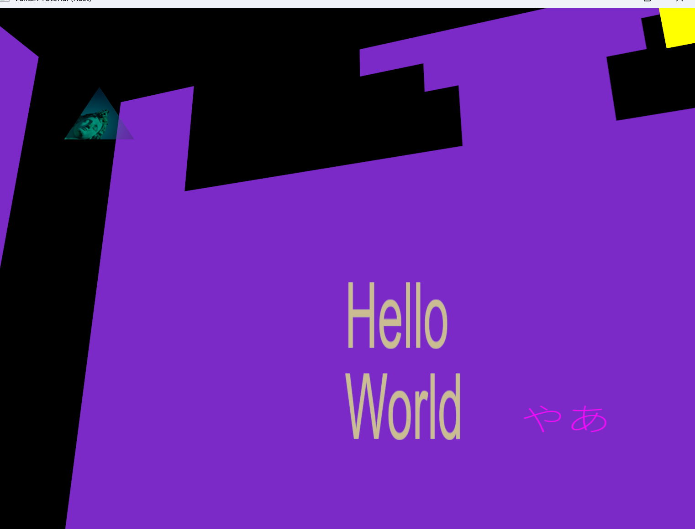
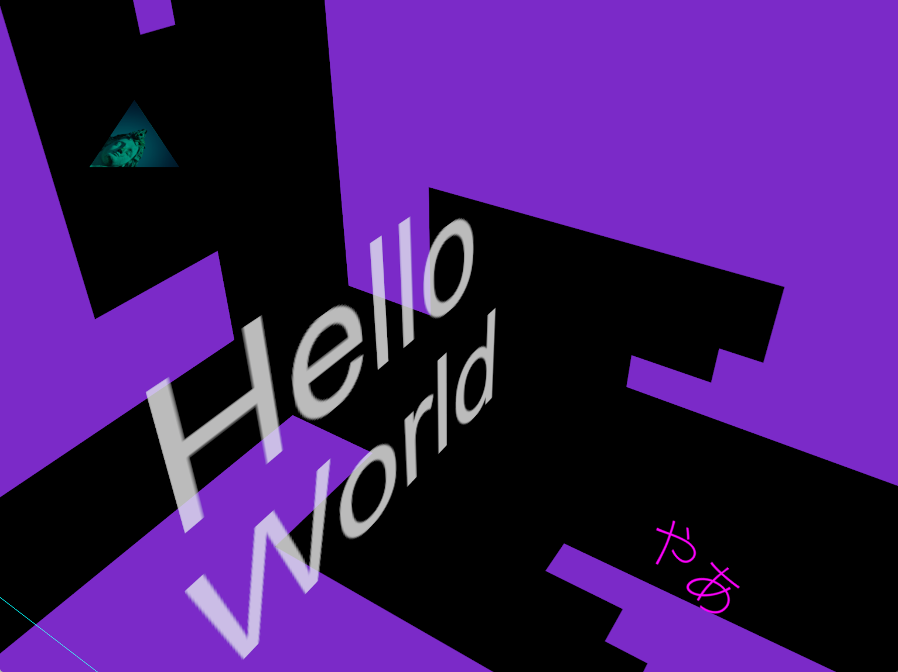
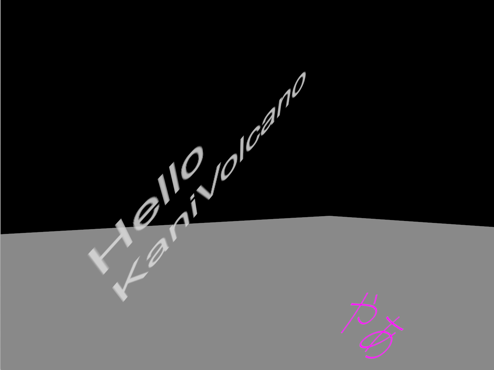
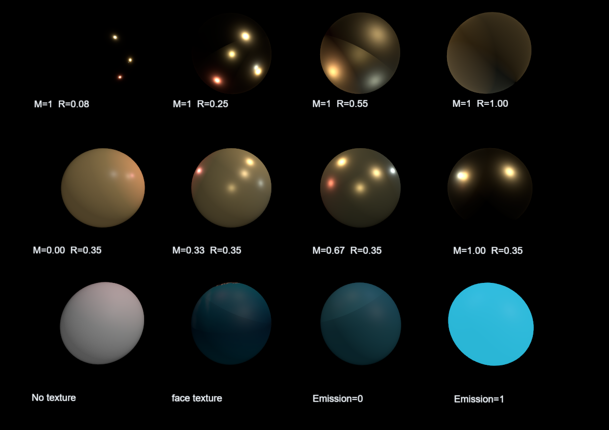

# Object API

Object API creates renderable objects such as models and primitive shapes.

It is available from contexts that implement `ObjectApi`, such as `SceneContext`, `UpdateContext`, and `CommandContext`.

Object API functions usually create an entity and automatically attach the components needed for rendering.

## Models

Models must be loaded from `App` before they can be spawned.

```rust
unsafe {
    app.load_model(
        "viking_room_lit3d",
        "assets/models/viking_room.obj",
        PipelineKey::Lit3D,
        false,
    )?;
}
```

`load_model()` selects a `PipelineKey`, which decides the vertex layout used by the model. The loaded model is registered as a mesh asset.

Spawn the model from a context.

```rust
let texture = context
    .texture("viking_room")
    .unwrap_or(context.default_texture());

context.spawn_model(
    "viking_room_lit3d",
    Transform {
        position: vec3(-3.0, -1.0, 1.0),
        rotation: vec3(0.0, 0.0, 0.0),
        scale: vec3(1.0, 1.0, 1.0),
    },
    Material {
        color: vec3(1.0, 1.0, 1.0),
        alpha: 1.0,
        use_texture: true,
        texture,
        pipeline_key: PipelineKey::Lit3D,
    },
)?;
```


`spawn_model()` attaches these components:

- `Transform`
- `MeshRenderer`
- `Visibility`
- `Tags`: `["Model", model_name]`

The `Material.pipeline_key` must match the pipeline used when the model was loaded.

## Primitive Shapes

Primitive functions create basic shapes.

- `Triangle`
- `Rectangle`
- `Cube`
- `Circle`
- `Polygon`
- `Sphere`
- `Line`

### Triangle

```rust
context.spawn_triangle_3d(
    vec3(-3.0, -1.0, 1.5),
    vec3(-3.0, -1.5, 0.8),
    vec3(-3.0, -0.5, 0.8),
    vec3(1.0, 0.0, 0.0),
    1.0,
    None,
    PipelineKey::Lit3D,
)?;
```


### Rectangle

```rust
context.spawn_rectangle_3d(
    vec3(-3.0, -1.0, 1.0),
    0.6,
    0.6,
    vec3(0.0, 0.0, 0.0),
    vec3(1.0, 0.0, 0.0),
    1.0,
    None,
    PipelineKey::Lit3D,
)?;
```


### Cube

```rust
context.spawn_cube_3d(
    vec3(-3.0, -1.0, 1.0),
    1.0,
    vec3(0.0, 0.0, 0.0),
    vec3(1.0, 0.0, 0.0),
    1.0,
    None,
    PipelineKey::Lit3D,
)?;
```


### Cuboid
### Cuboid: 直方体の生成
```rust
fn create_cuboids(&mut self, context: &mut SceneContext<'_>) -> Result<()>{
    let items=vec![
        (vec3(-3.0,-1.0,1.0),0.5,0.2,1.0,vec3(1.0,0.0,0.0),1.0,PipelineKey::Lit3D),
        (vec3(-3.0,1.0,1.0),0.2,0.5,1.0,vec3(0.0,1.0,0.0),1.0,PipelineKey::Mesh3D),
        (vec3(-3.0,1.0,-1.0),1.0,0.5,0.2,vec3(1.0,1.0,1.0),1.0,PipelineKey::DebugLine3D),
        (vec3(-3.0,-1.0,-1.0),0.5,1.0,0.2,vec3(0.0,0.0,1.0),0.5,PipelineKey::Transparent3D),
    ];

    for item in items{
        let cuboid=context.spawn_cuboid_3d(
            item.0, // position
            item.1, // width
            item.2, // depth
            item.3, // height
            vec3(0.0,0.0,0.0), // rotation
            item.4, // color
            item.5, // alpha
            None, // texture
            item.6 // PipelineKey
        );
    }

    Ok(())
}
```


### Circle

```rust
context.spawn_circle_3d(
    vec3(-3.0, -1.0, 1.0),
    0.5,
    32,
    vec3(1.0, 0.0, 0.0),
    1.0,
    None,
    PipelineKey::Lit3D,
)?;
```


### Polygon

```rust
context.spawn_polygon_3d(
    vec![
        vec3(-3.0, -1.2, 0.9),
        vec3(-3.0, -0.8, 0.5),
        vec3(-3.0, -0.5, 1.0),
        vec3(-3.0, -1.2, 1.8),
        vec3(-3.0, -1.4, 1.9),
    ],
    vec3(1.0, 0.0, 0.0),
    1.0,
    None,
    PipelineKey::Lit3D,
)?;
```


For `Lit3D`, polygon lighting depends on the direction of the normal. If the polygon looks dark, reverse the point order.

### Sphere

```rust
context.spawn_sphere_3d(
    vec3(-3.0, -1.0, 1.0),
    1.0,
    32,
    32,
    vec3(1.0, 0.0, 0.0),
    1.0,
    None,
    PipelineKey::Lit3D,
)?;
```


### Line

```rust
context.spawn_line_3d(
    vec3(-20.0, 0.0, 0.0),
    vec3(20.0, 0.0, 0.0),
    vec3(1.0, 0.0, 0.0),
    1.0,
)?;
```


## 2D UI Primitives

2D primitive functions draw shapes on the screen.

```rust
context.spawn_triangle_2d(
    vec2(-0.5, 0.5),
    vec2(-0.8, -0.2),
    vec2(-0.2, -0.2),
    vec3(1.0, 0.0, 0.0),
    1.0,
    None,
)?;

context.spawn_rectangle_2d(
    vec2(0.5, 0.5),
    0.5,
    0.3,
    0.0,
    vec3(0.0, 1.0, 0.0),
    1.0,
    None,
)?;

context.spawn_circle_2d(
    vec2(0.5, -0.5),
    0.3,
    32,
    vec3(1.0, 1.0, 1.0),
    1.0,
    Some("viking_room"),
)?;
```


## Text Rendering

### 2D

You can render text on the screen.

```rust
let hello_world = context.spawn_text_ui2d(
    "eng_font", // font name
    "Hello\nWorld", // text
    100.0, // font size
    100.0, // line height
    vec2(0.0, 0.0), // position
    vec2(1.0, 2.0), // scale
    0.0, // rotation
    vec3(1.0, 1.0, 0.0), // color
    0.5, // alpha
);

let ya = context.spawn_text_ui2d(
    "jpn_font",
    "やあ",
    100.0,
    100.0,
    vec2(0.5, 0.5),
    vec2(1.0, 2.0),
    0.0,
    vec3(1.0, 0.0, 1.0),
    1.0,
);
```



You can also render text by adding a `Text` component to an entity.

```rust
let font = context.font_asset_id("eng_font")?;

let hello_world = context.spawn();

context.add_component(
    hello_world,
    Transform {
        position: vec3(0.0, 0.0, 0.0),
        scale: vec3(1.0, 2.0, 0.0),
        ..Default::default()
    },
);

context.add_component(
    hello_world,
    Text {
        content: "Hello\nWorld".to_string(),
        font: font,
        font_size: 100.0,
        line_height: 100.0,
        color: vec3(1.0, 1.0, 0.0),
        alpha: 0.5,
    },
);
```

### 3D

You can render text in 3D space.

```rust
let hello_world = context.spawn_text_3d(
    "eng_font", // font name
    "Hello\nWorld", // text
    100.0, // font size
    100.0, // line height
    vec3(-5.0, 1.0, -1.0), // position
    vec3(0.01, 0.01, 0.01), // scale (to match world coordinates)
    vec3(0.0, 0.0, 0.0), // rotation
    vec3(1.0, 1.0, 1.0), // color
    0.5, // alpha
);
```



You can also rotate 3D text.

```rust
let hello_kani_volcano = context.spawn_text_3d(
    "eng_font",
    "Hello\nKaniVolcano",
    48.0,
    60.0,
    vec3(-3.0, 0.0, 0.0),
    vec3(0.01, 0.01, 0.01),
    vec3(45.0, 45.0, 0.0),
    vec3(1.0, 1.0, 1.0),
    0.5,
);
```



## Draw Order

For 3D objects, rendering order is determined by their position relative to the camera. In contrast, UI2D shapes and text require an explicitly defined draw order.

If no draw order is specified, UI2D elements are rendered in the order they were created, which may result in unintended overlapping.

You can control the rendering order using the following API:

```rust
context.set_draw_order(entity: EntityId, order: i32)
```

For example:

```rust
context.set_draw_order(background, -100);
context.set_draw_order(button, 10);
context.set_draw_order(popup, 100);
```

Elements with higher draw order values are rendered on top of those with lower values.

## Material Configuration

Materials determine the visual appearance and surface properties of objects when rendered.

```rust
pub struct Material {
    pub base_color: Vector4<f32>, // Base color (Supported)
    pub base_color_texture: Option<TextureHandle>, // Base color texture (Supported)

    // Surface properties
    pub metallic: f32, // Metallic factor (Supported)
    pub roughness: f32, // Surface roughness (Supported)
    pub metallic_roughness_texture: Option<TextureHandle>, // Per-pixel roughness (G) and metallic (B) values (Not supported)

    // Normal mapping (Not supported)
    pub normal_texture: Option<TextureHandle>, // Normal map for surface detail
    pub normal_scale: f32, // Normal map intensity

    // Emission
    pub emissive_color: Vector3<f32>, // Emissive color (Supported)
    pub emissive_strength: f32, // Emissive intensity multiplier (Supported)
    pub emissive_texture: Option<TextureHandle>, // Emissive texture (Not supported)

    // Ambient occlusion
    pub occlusion_strength: f32, // Controls the intensity of ambient occlusion (Not supported)

    // Transparency (Not supported)
    pub alpha_mode: AlphaMode, // Opaque, alpha masking, or alpha blending
    pub alpha_cutoff: f32, // Alpha threshold for Mask mode

    // Back-face rendering
    pub double_sided: bool, // Enables or disables back-face culling (Not supported)

    pub pipeline_key: PipelineKey,
}

pub enum AlphaMode {
    Opaque,
    Mask,
    Blend,
}
```

You can assign a material to an entity using `context.set_material()`:

```rust
context.set_material(entity, Material {
    base_color,
    base_color_texture,
    metallic,
    roughness,
    ..Material::default()
});
```



## Reusing Existing Primitive Meshes

You can get an existing primitive mesh and create another entity from it.

```rust
let mesh = context
    .primitive_asset_id(
        PrimitiveType::Cube,
        PipelineKey::Lit3D.required_vertex_layout(),
    )
    .ok_or_else(|| anyhow!("cube lit3d mesh not found"))?;

context.spawn_primitive_from_mesh(
    mesh,
    Material {
        color: vec3(1.0, 1.0, 1.0),
        alpha: 1.0,
        use_texture: false,
        texture: context.default_texture(),
        pipeline_key: PipelineKey::Lit3D,
    },
    Transform {
        position: vec3(-3.0, 0.5, 0.5),
        scale: vec3(0.3, 0.3, 0.3),
        ..Default::default()
    },
)?;
```

This reuses the mesh itself. The new entity can still have its own `Transform` and `Material`.

## Notes

`spawn_*_3d()` creates a new primitive mesh through a render command. The mesh is not available immediately in the same function. It becomes available after the render stage processes the command.

If you need a mesh immediately, use a primitive mesh that was already registered at startup, or wait until `primitive_asset_id()` returns `Some`.